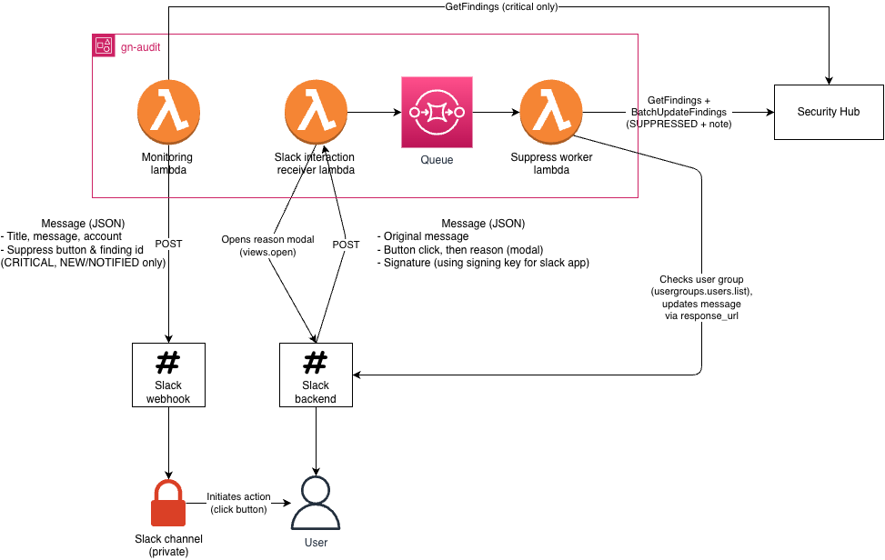

# Slack interaction: suppress Security Hub findings

Real-time Security Hub alerts in Slack can have a Suppress button. A member of a configured Slack user group clicks
it, enters a reason, and the finding is set to `SUPPRESSED` in Security Hub with the reason as a note. The daily
Security Hub overview has no buttons.

The feature is off until `securityHubActionsUserGroupId` is set for an environment (see [Setup](#setup-per-environment)).
Until then no endpoint is deployed and no button is shown.

## When the button appears
Only on `CRITICAL` alerts for now (`SUPPRESS_SEVERITY` in `src/monitoringLambda/SecurityHubView.ts`). The monitoring
Lambda looks up the finding with `GetFindings` and shows the button when exactly one finding matches and its workflow
status is `NEW` or `NOTIFIED`.

If the finding is already handled, the alert is posted without a button. If the lookup finds nothing, finds several
findings or fails, the alert is posted without a button and says "Actions unavailable for this alert" (when a user
group is configured). The lookup never stops an alert from being posted.

Clicking opens a modal that asks for a reason. On submit the request is queued, and a worker suppresses the finding
and redraws the Slack message with the new status, who did it and the reason.

## Setup per environment
Each environment has its own Slack app, API Gateway, signing secret and bot token: `main` uses the Monitoring app,
`sandbox` uses Sandbox monitoring.

1. In the Slack app, under OAuth & Permissions, add the bot scope `usergroups:read` (see
   `src/audit/slackbot-manifest.json`).
2. Under Interactivity & Shortcuts, enable Interactivity and set the request URL to the API Gateway URL of that
   environment's `IntegrationsStack` plus `/slack`, for example
   `https://<api-id>.execute-api.<region>.amazonaws.com/prod/slack`. The Events URL stays `.../slackbot`.
3. Reinstall the app so the new scope takes effect.
4. Store these as plain text in the Secrets Manager secrets created by `src/audit/AuditSupport.ts` (the physical
   names have a generated suffix; the dev secrets may still be empty):
   - `slackbot-secret-<env>`: the Signing Secret (Basic Information)
   - `slack-bot-token-<env>`: the Bot User OAuth Token (`xoxb-...`)
5. Set `securityHubActionsUserGroupId` to the Slack user group ID (starts with `S`) for the environment in
   `src/DeploymentEnvironments.ts` and deploy. Synthesis fails if `deployAuditSlackbot` is not also set. Both `main`
   and `sandbox` leave it unset today.

Alerts go out through the SSM incoming webhooks (`/monitoring/slack-webhook-url-<prefix>-<priority>`), and Slack sends
a click to the Interactivity URL of the app that owns the webhook. Each environment's webhooks must therefore belong
to its own Slack app.

Prod and dev both run in the audit account and read the same findings, so a click in the dev app changes real
findings. Keep the dev user group to testers.

## Behavior
- Anyone can open the modal. The worker then checks user group membership with `usergroups.users.list`; if the user
  is not a member or the check fails, nothing changes.
- The reason is required and at most 400 characters (enforced by the form and again by the receiver). The note reads
  `Suppressed via Slack by <user id>: <reason>`, cut to Security Hub's 512 characters, and replaces any earlier note.
  Older notes stay in the finding history.
- The reason is escaped, so `<!channel>` or `<@user>` in it notifies nobody.
- The worker reads the finding again before writing. If it is no longer `NEW` or `NOTIFIED`, no longer `CRITICAL`,
  or gone, nothing is written; the user gets an ephemeral message with the current status and last note, and the
  message is redrawn. An already `SUPPRESSED` finding counts as success.
- Replies and the redraw use Slack's `response_url`, which expires after 30 minutes. A later suppress still works,
  only the redraw fails (and is logged). The worker only calls `hooks.slack.com` for these.
- `BatchUpdateFindings` emits a new event, so a suppress can trigger a new alert if the landing-zone forwarding rule
  does not filter on workflow status. Check this in the end-to-end test.

## Troubleshooting
| Symptom | Check |
|---|---|
| Nothing happens after Submit | Receiver and worker logs. Open the function in the Lambda console (Monitor, View CloudWatch logs), or find `receiver-logs` and `worker-logs` under `security-hub-actions` in the `IntegrationsStack` resources. A bad signature gets 403 and logs "authentication failed". |
| Clicking does nothing and nothing is logged | The webhook belongs to another Slack app, or is a legacy webhook. Recreate it in the environment's own app and update the SSM parameter. |
| Slack says the URL did not respond / `dispatch_failed` | The Interactivity URL must end in `/slack`, and the signing secret must be filled in. |
| No button on a critical alert | User group ID not configured, the lookup found zero or several findings, or the finding is not `NEW`/`NOTIFIED`. |

The user sees failures as ephemeral messages such as "You are not allowed to suppress findings." or "Suppressing the
finding failed. Please try again." The worker log line "Suppress request handled" has the outcome, finding id, Slack
user id and reason length, never the reason or the raw request.

The worker logs and drops bad or failing records itself, so the DLQ only fills when the Lambda crashes or times out.
Messages get one retry (`maxReceiveCount: 2`), then stay in the DLQ for 14 days; the main queue keeps them for 1 hour.
There is no DLQ alarm, so check the DLQ in the SQS console.

## Related
`docs/slack-integration-dataflow.drawio.png` can be opened and edited in drawio. `docs/SlackInteraction.drawio.png`
shows an older, unrelated flow (a Slack button that creates a TopDesk incident).
